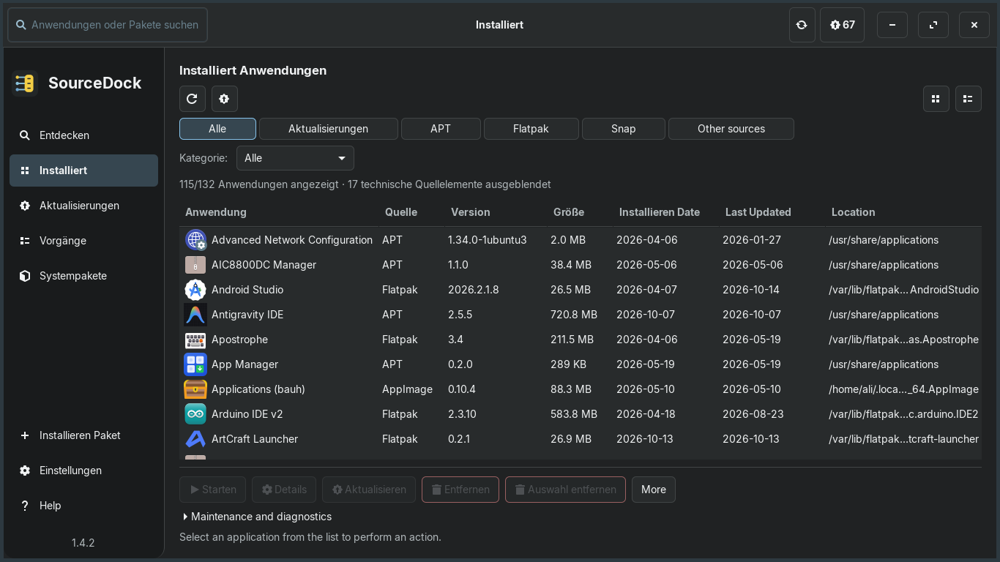
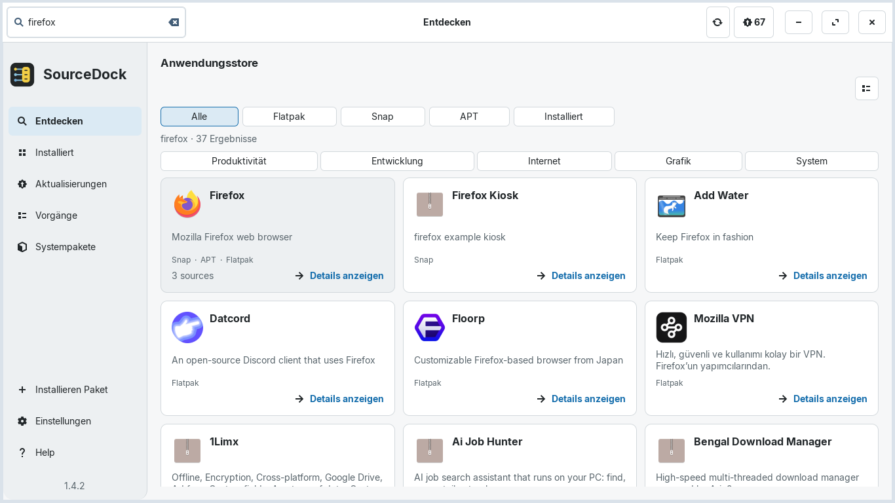
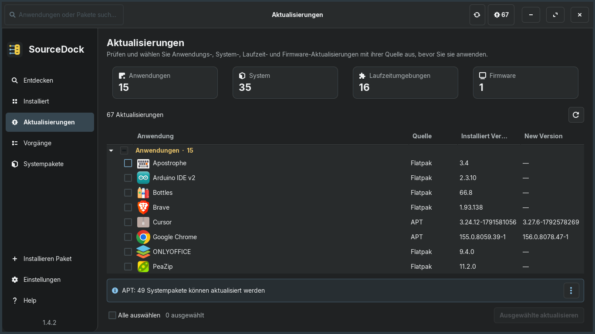

<div align="center">

[ **English** ](README.md) &nbsp;•&nbsp; [ **Türkçe** ](README.tr.md) &nbsp;•&nbsp; [ **Deutsch** ](README.de.md) &nbsp;•&nbsp; [ **Español** ](README.es.md) &nbsp;•&nbsp; [ **Português (BR)** ](README.pt_BR.md) &nbsp;•&nbsp; [ **Français** ](README.fr.md)

<br/>


# SourceDock

**Eine native GTK-3-Anwendung und Paketverwaltung für Linux.**

[](https://github.com/aliafacan/SourceDock/actions) [](LICENSE)

</div>

SourceDock verwaltet Anwendungen und Pakete aus APT, Flatpak, Snap und lokalen Paketdateien in einer einzigen, responsiven Oberfläche. Die Anwendung arbeitet asynchron, zeigt Anbieterfehler transparent an und fordert erhöhte Rechte erst für die jeweilige bestätigte Aktion an.

## Screenshots

Die folgenden Bilder zeigen die aktuelle 1.4.2-Oberfläche auf Deutsch:





## Funktionen

- Einheitliche Ansicht für installierte Anwendungen, Pakete, Updates und Store-Suche.
- APT-Unterstützung sowie Parser für DNF, Pacman und Zypper; Flatpak und Snap optional.
- Lokale `.deb`-Vorschau mit Version, Architektur, Abhängigkeiten und Installationsstatus.
- Dunkles, helles und System-Theme, Skalierung von 90–125 % und sechs Sprachen.
- Periodische GitHub-Release-Prüfung mit verifiziertem DEB-Self-Update über SHA-256.
- Sichere, nicht blockierende Transaktionen mit Sperren, Timeouts und geschütztem Passwort-Cache.

## Installation

Die aktuelle Version ist [SourceDock 1.4.2](https://github.com/aliafacan/SourceDock/releases/tag/v1.4.2). Lade die DEB-Datei und die SHA-256-Datei herunter:

```bash
sha256sum -c sourcedock_1.4.2_all.deb.sha256
sudo apt install ./sourcedock_1.4.2_all.deb
sourcedock
```

SourceDock kann neue Releases melden und die geprüfte DEB-Datei anschließend im bestehenden Paket- und Berechtigungsdialog öffnen. Die Installation erfolgt niemals still im Hintergrund; nach der Installation ist ein Neustart erforderlich.

## Kompatibilität

- Zorin OS 18.1: reale Installation und APT-Lebenszyklus geprüft.
- Ubuntu 22.04 und 24.04: CI PASS, 296/296 Tests unter Xvfb/Openbox.
- Debian 12: kompatibel; Debian 11 benötigt Python 3.10 oder neuer.
- Fedora, openSUSE und Arch: experimentell, native Paketierung noch nicht enthalten.

Details stehen in der [Kompatibilitätsmatrix](docs/COMPATIBILITY.md).

## Entwicklung

Voraussetzungen: Python 3.10+, PyGObject, GTK 3, Xvfb, Openbox und `dpkg-dev`.

```bash
python3 main.py
xvfb-run -a bash -c 'openbox >/dev/null 2>&1 & wm=$!; trap "kill $wm 2>/dev/null || true" EXIT; /usr/bin/python3 tools/run_tests.py --require-wm'
bash packaging/build_deb.sh dist
```

Weitere Dokumente: [Beitragsleitfaden](CONTRIBUTING.md), [Architektur](docs/ARCHITECTURE.md), [Lokalisierung](docs/LOCALIZATION.md), [Änderungsprotokoll](CHANGELOG.md) und [Lizenz](LICENSE).
