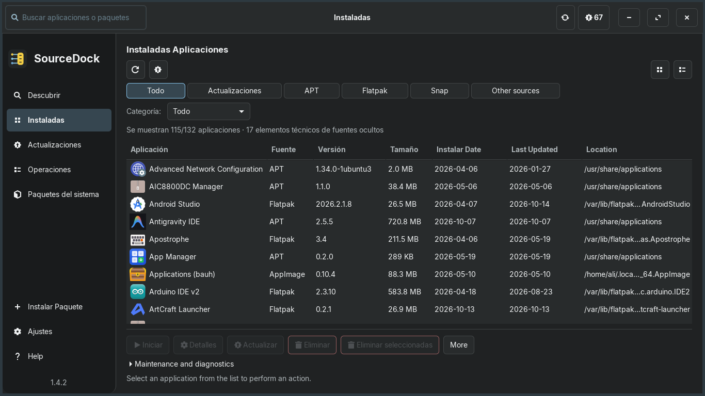
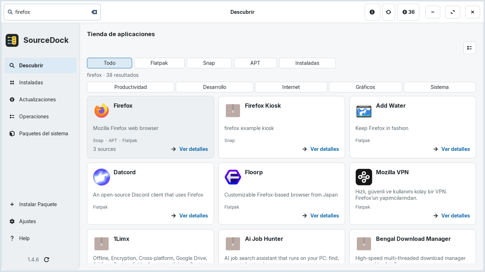
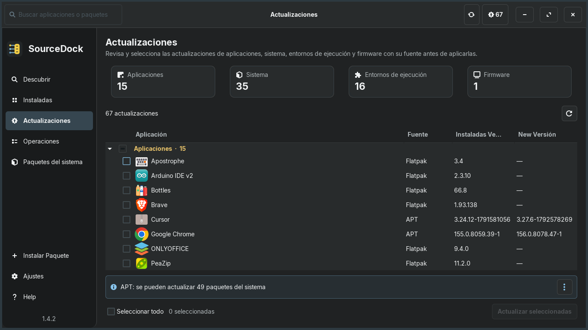

<div align="center">

[ **English** ](README.md) &nbsp;•&nbsp; [ **Türkçe** ](README.tr.md) &nbsp;•&nbsp; [ **Deutsch** ](README.de.md) &nbsp;•&nbsp; [ **Español** ](README.es.md) &nbsp;•&nbsp; [ **Português (BR)** ](README.pt_BR.md) &nbsp;•&nbsp; [ **Français** ](README.fr.md)

<br/>


# SourceDock

**Aplicación de escritorio y gestor de paquetes nativo GTK 3 para Linux.**

[](https://github.com/aliafacan/SourceDock/actions) [](LICENSE)

</div>

SourceDock reúne la búsqueda, instalación, actualización y eliminación de aplicaciones APT, Flatpak, Snap y paquetes locales en una interfaz rápida y unificada. Las consultas se ejecutan de forma asíncrona y los errores de cada proveedor se muestran sin ocultar los resultados disponibles.

## Capturas de pantalla

Las siguientes imágenes muestran la interfaz actual de la versión 1.4.3 en español:





## Funciones principales

- Vistas unificadas para aplicaciones instaladas, paquetes, actualizaciones y tienda.
- Integración con APT y modelos para DNF, Pacman y Zypper; Flatpak y Snap son opcionales.
- Vista previa de paquetes `.deb` con versión, arquitectura, dependencias y estado.
- Temas oscuro, claro y del sistema, escala del 90–125 % y seis idiomas.
- Comprobación periódica de GitHub y actualización propia mediante DEB con SHA-256 verificado.
- Operaciones seguras sin bloquear la interfaz, con límites de tiempo y credenciales protegidas.

## Instalación

Descarga la versión [SourceDock 1.4.3](https://github.com/aliafacan/SourceDock/releases/tag/v1.4.3) y su checksum:

```bash
sha256sum -c sourcedock_1.4.3_all.deb.sha256
sudo apt install ./sourcedock_1.4.3_all.deb
sourcedock
```

Cuando hay una nueva versión, SourceDock puede descargar el DEB publicado en GitHub, verificar su checksum y abrir el flujo habitual de vista previa y autorización. La instalación siempre requiere confirmación del usuario; después hay que reiniciar la aplicación.

## Compatibilidad

- Zorin OS 18.1: instalación real y ciclo APT verificados.
- Ubuntu 22.04 y 24.04: CI PASS, 296/296 pruebas con Xvfb/Openbox.
- Debian 12: compatible; Debian 11 requiere Python 3.10 o posterior.
- Fedora, openSUSE y Arch: soporte experimental y sin paquetes nativos todavía.

Consulta la [matriz de compatibilidad](docs/COMPATIBILITY.md) para más detalles.

## Desarrollo

Requisitos: Python 3.10+, PyGObject, GTK 3, Xvfb, Openbox y `dpkg-dev`.

```bash
python3 main.py
xvfb-run -a bash -c 'openbox >/dev/null 2>&1 & wm=$!; trap "kill $wm 2>/dev/null || true" EXIT; /usr/bin/python3 tools/run_tests.py --require-wm'
bash packaging/build_deb.sh dist
```

Consulta [Contribuir](CONTRIBUTING.md), [Arquitectura](docs/ARCHITECTURE.md), [Localización](docs/LOCALIZATION.md), [registro de cambios](CHANGELOG.md) y [licencia](LICENSE).
