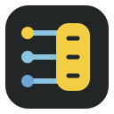
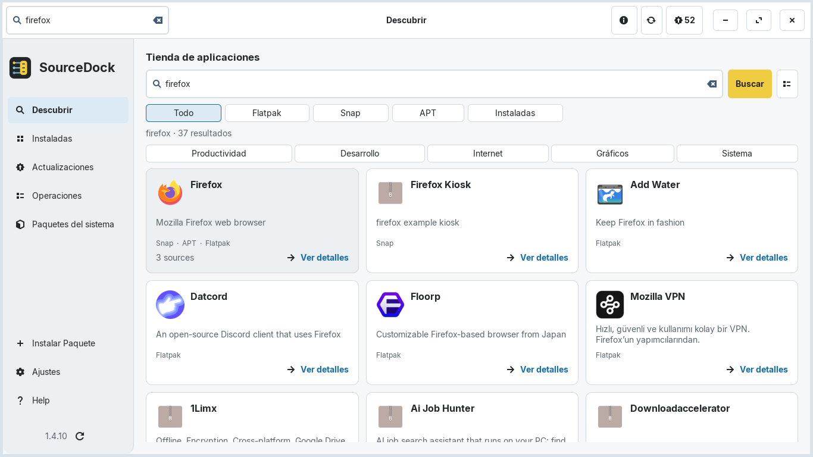
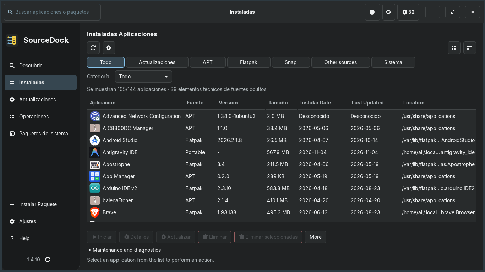
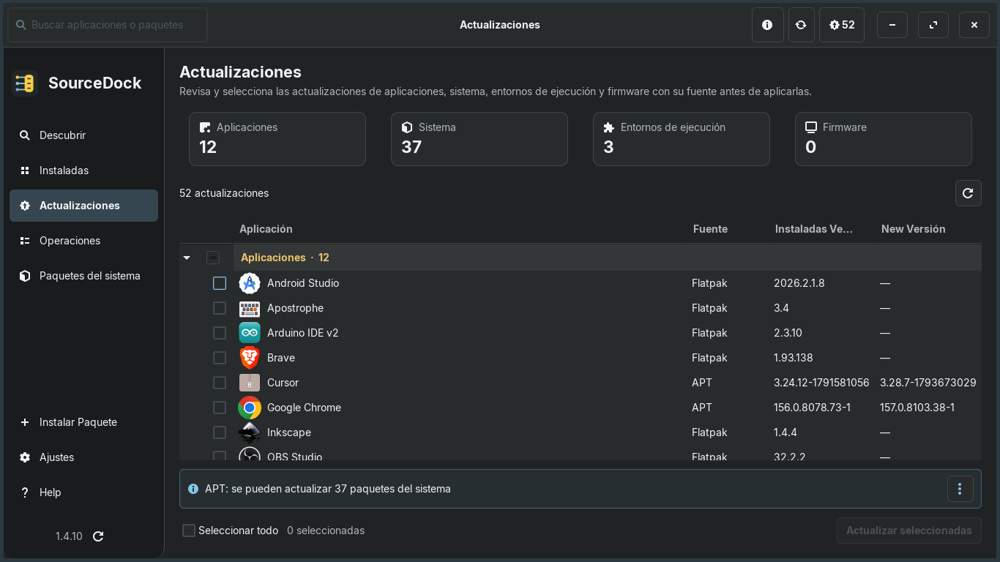
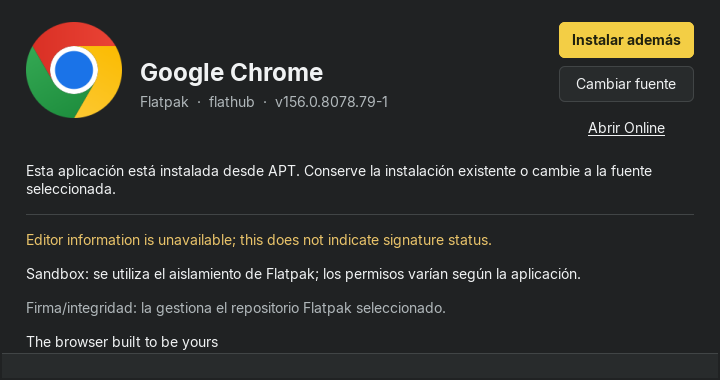
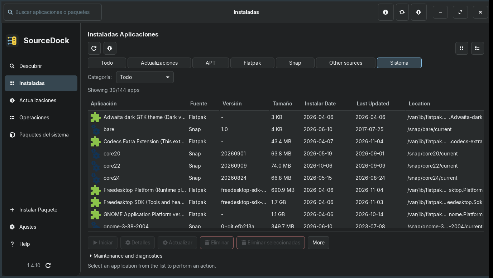

<div align="center">

[ **English** ](README.md) &nbsp;•&nbsp; [ **Türkçe** ](README.tr.md) &nbsp;•&nbsp; [ **Deutsch** ](README.de.md) &nbsp;•&nbsp; [ **Español** ](README.es.md) &nbsp;•&nbsp; [ **Português (BR)** ](README.pt_BR.md) &nbsp;•&nbsp; [ **Français** ](README.fr.md)

<br/>



# SourceDock

**Aplicación de escritorio y gestor de paquetes nativo GTK 3 para Linux.**

[](https://github.com/aliafacan/SourceDock/actions) [](LICENSE)

</div>

SourceDock reúne la búsqueda, instalación, actualización y eliminación de aplicaciones APT, Flatpak, Snap y paquetes locales en una interfaz rápida y unificada. Las consultas se ejecutan de forma asíncrona y los errores de cada proveedor se muestran sin ocultar los resultados disponibles.

## Novedades de 1.4.10

- **Inicio más rápido:** se reutiliza la lista guardada si no cambian las bases de paquetes ni los indicadores de instalación. Los cambios externos, la caducidad de la caché o F5 fuerzan una nueva exploración. Antigravity se vincula mediante su clase de ventana definitiva.
- **Listas estables:** tras instalar, eliminar o actualizar se reconcilia solo la fuente afectada, sin recargar la página ni repetir la búsqueda de actualizaciones.
- **Filtro Sistema:** los runtimes de Flatpak y paquetes base de Snap instalados permanecen visibles aunque no tengan actualizaciones. Su eliminación exige una advertencia clara y escribir el nombre del paquete.
- **Seguir trabajando durante operaciones:** la búsqueda y los filtros siguen activos. Distintos gestores pueden trabajar en paralelo; las modificaciones de una misma base de paquetes se ponen en cola.
- **Cambiar la fuente de una aplicación:** se reconocen instalaciones equivalentes nativas, Flatpak y Snap. Puede instalar en paralelo o cambiar de fuente. La nueva instalación se verifica antes de eliminar la copia anterior seleccionada sin purge. Los perfiles y sesiones no se transfieren automáticamente.
- **Progreso más claro:** una sola barra de progreso medido, registros detallados opcionales, selector de archivos legible y mejores iconos e integración de aplicaciones Electron portátiles.
- **Búsqueda resistente:** Snap dispone de 15 segundos; los resultados rápidos de otras fuentes aparecen sin esperar. Los tiempos de espera muestran mensajes traducidos para reintentar en lugar de comandos internos.

Use [build.sh](build.sh) para empaquetar e instalar las fuentes actuales. Verifica el checksum e instala o reinstala con APT; solo solicita permisos de administrador para instalar.

```bash
./build.sh
```

## Capturas de pantalla

Capturas nuevas de la versión 1.4.10: ventanas principales de 1366×768 y diálogos en su tamaño propio.





### Cambiar la fuente de una aplicación



### Componentes compartidos del sistema



Capturas de SourceDock 1.4.10 con metadatos reales consultados en modo de solo lectura; no se ejecutaron operaciones de paquetes.

## Funciones principales

- Vistas unificadas para aplicaciones instaladas, paquetes, actualizaciones y tienda.
- Secciones claras para tienda, aplicaciones instaladas, actualizaciones, operaciones, paquetes del sistema, instalación de paquetes, ajustes y ayuda; las actualizaciones se agrupan en aplicaciones, sistema, runtimes y firmware.
- APT como integración nativa principal; DNF, Pacman y Zypper son experimentales; Flatpak y Snap son opcionales.
- Vista previa de paquetes `.deb` con versión, arquitectura, dependencias y estado.
- Temas oscuro, claro y del sistema, escala del 90–125 % y seis idiomas.
- Comprobación periódica de GitHub y actualización propia mediante DEB con SHA-256 verificado.
- Operaciones seguras sin bloquear la interfaz, con límites de tiempo y credenciales protegidas.

## Instalación

Descarga la versión [SourceDock 1.4.10](https://github.com/aliafacan/SourceDock/releases/tag/v1.4.10) y su checksum:

```bash
sha256sum -c sourcedock_1.4.10_all.deb.sha256
sudo apt install ./sourcedock_1.4.10_all.deb
sourcedock
```

Cuando hay una nueva versión, SourceDock puede descargar el DEB publicado en GitHub, verificar su checksum y abrir el flujo habitual de vista previa y autorización. La instalación siempre requiere confirmación del usuario; después hay que reiniciar la aplicación.

### Desinstalación

Para eliminar SourceDock conservando la configuración del usuario:
```bash
sudo apt remove sourcedock
```

Para eliminar SourceDock junto con la configuración del paquete y la caché local:
```bash
sudo apt purge sourcedock
rm -rf ~/.cache/sourcedock ~/.config/sourcedock
sudo apt autoremove
```

Si está instalado el paquete antiguo `voltapp`:
```bash
sudo apt purge voltapp
```

## Compatibilidad

- Zorin OS 18.1: instalación real y ciclo APT verificados.
- Ubuntu 22.04 y 24.04: cubiertos por el flujo CI con Xvfb/Openbox, unittest, Ruff, compileall y compilación `.deb`; aquí no se afirma un resultado remoto actual.
- Debian 12: compatible; Debian 11 requiere Python 3.10 o posterior.
- Fedora, openSUSE y Arch: soporte experimental y sin paquetes nativos todavía.

Consulta la [matriz de compatibilidad](docs/COMPATIBILITY.md) para más detalles.

## Desarrollo

Requisitos: Python 3.10+, PyGObject, GTK 3, Xvfb, Openbox y `dpkg-dev`.

```bash
python3 main.py
xvfb-run -a bash -c 'openbox >/dev/null 2>&1 & wm=$!; trap "kill $wm 2>/dev/null || true" EXIT; /usr/bin/python3 tools/run_tests.py --require-wm'
bash packaging/build_deb.sh dist
```

Consulta [Contribuir](CONTRIBUTING.md), el [código de conducta](CODE_OF_CONDUCT.md), la [política de seguridad](SECURITY.md), [Arquitectura](docs/ARCHITECTURE.md), [Localización](docs/LOCALIZATION.md), el [registro de cambios](CHANGELOG.md) y la [licencia](LICENSE).
