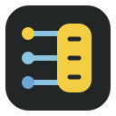
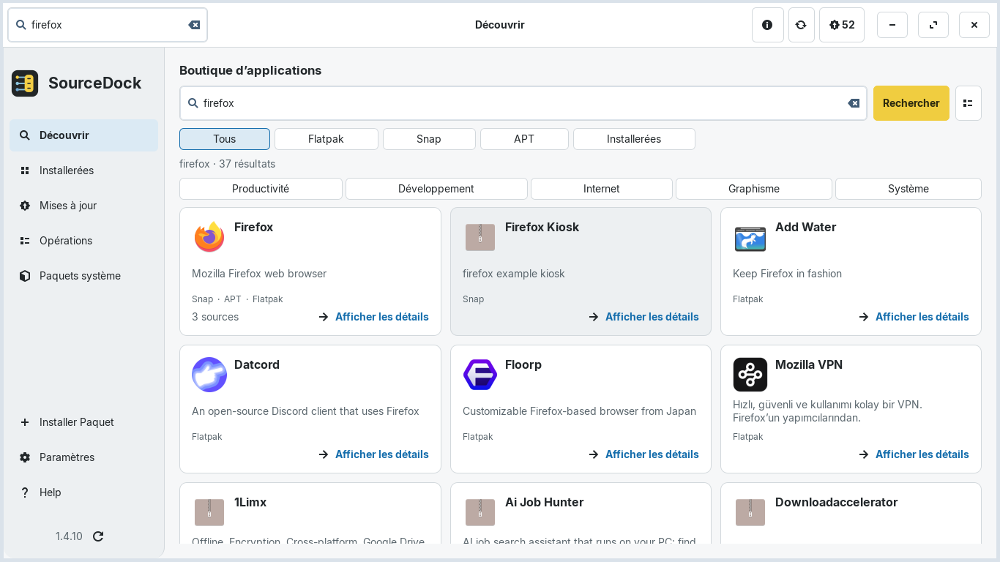
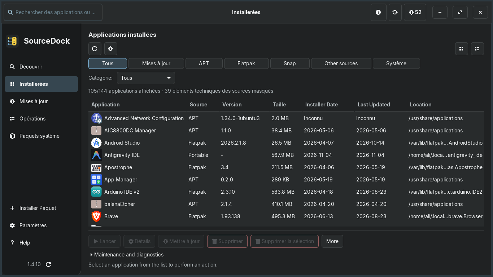
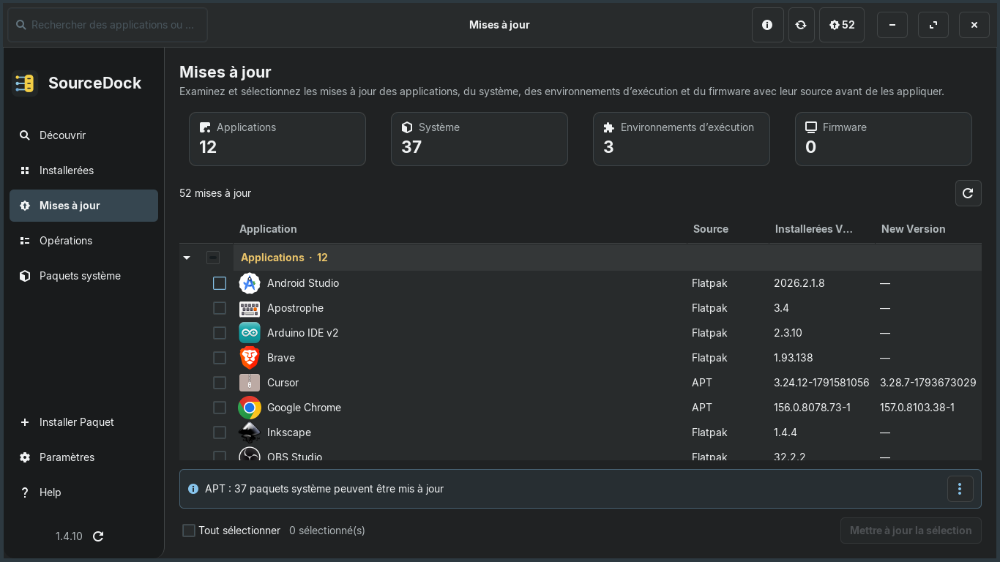
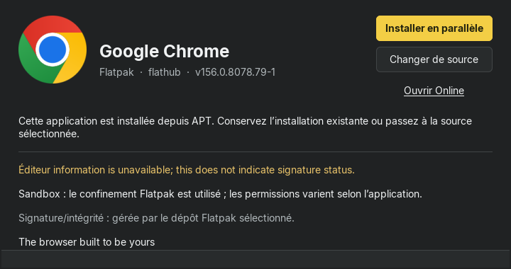
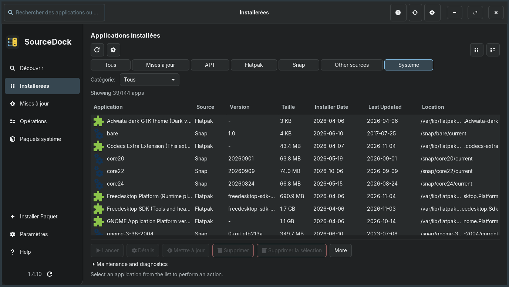

<div align="center">

[ **English** ](README.md) &nbsp;•&nbsp; [ **Türkçe** ](README.tr.md) &nbsp;•&nbsp; [ **Deutsch** ](README.de.md) &nbsp;•&nbsp; [ **Español** ](README.es.md) &nbsp;•&nbsp; [ **Português (BR)** ](README.pt_BR.md) &nbsp;•&nbsp; [ **Français** ](README.fr.md)

<br/>



# SourceDock

**Application de bureau et gestionnaire de paquets Linux natif en GTK 3.**

[](https://github.com/aliafacan/SourceDock/actions) [](LICENSE)

</div>

SourceDock réunit la recherche, l’installation, la mise à jour et la suppression des applications APT, Flatpak, Snap et des paquets locaux dans une interface réactive. Les fournisseurs sont interrogés de manière asynchrone et leurs erreurs sont affichées séparément.

## Nouveautés de la version 1.4.10

- **Listes stables :** après une installation, suppression ou mise à jour, seule la source concernée est réconciliée, sans recharger la page ni relancer la recherche de mises à jour.
- **Filtre Système dédié :** les runtimes Flatpak et paquets de base Snap installés restent visibles indépendamment des mises à jour. Leur suppression exige un avertissement et la saisie du nom du paquet.
- **Continuer pendant les opérations :** recherche et filtres restent disponibles. Des gestionnaires différents peuvent travailler en parallèle ; les écritures dans une même base de paquets sont mises en file.
- **Changer la source d’une application :** les installations natives, Flatpak et Snap correspondantes sont reconnues. Installez en parallèle ou changez de source. La nouvelle installation est vérifiée avant de supprimer uniquement l’ancienne copie choisie, sans purge. Les profils et sessions ne sont pas transférés automatiquement.
- **Progression plus claire :** une seule barre de progression mesurée, journaux détaillés facultatifs, sélecteur de fichiers lisible et meilleure intégration des icônes et fenêtres Electron portables.
- **Recherche robuste :** Snap dispose de 15 secondes ; les résultats rapides des autres sources apparaissent sans attendre. Les délais dépassés affichent un message traduit pour réessayer plutôt que des commandes internes.

Utilisez [build.sh](build.sh) pour empaqueter et installer les sources actuelles. Le script vérifie le checksum et installe ou réinstalle avec APT ; les droits administrateur sont demandés uniquement pour l’installation.

```bash
./build.sh
```

## Captures d’écran

Nouvelles captures de la version 1.4.10 : fenêtres principales en 1366×768 et dialogues à leur taille propre.





### Changer la source d’une application



### Composants système partagés



Captures de SourceDock 1.4.10 avec des métadonnées système consultées en lecture seule ; aucune opération sur les paquets n’a été exécutée.

## Fonctionnalités

- Vues unifiées pour les applications installées, les paquets, les mises à jour et la boutique.
- Sections dédiées à la boutique, aux applications installées, aux mises à jour, aux opérations, aux paquets système, à l’installation, aux réglages et à l’aide ; les mises à jour sont regroupées par applications, système, runtimes et firmware.
- APT comme intégration native principale ; DNF, Pacman et Zypper sont expérimentaux ; Flatpak et Snap restent optionnels.
- Prévisualisation des paquets `.deb` avec version, architecture, dépendances et état d’installation.
- Thèmes sombre, clair et système, échelle de 90 à 125 % et six langues.
- Vérification périodique des releases GitHub et auto-mise à jour DEB avec checksum SHA-256.
- Transactions asynchrones sécurisées avec verrous, délais et protection des identifiants.

## Installation

Téléchargez [SourceDock 1.4.10](https://github.com/aliafacan/SourceDock/releases/tag/v1.4.10) et son checksum :

```bash
sha256sum -c sourcedock_1.4.10_all.deb.sha256
sudo apt install ./sourcedock_1.4.10_all.deb
sourcedock
```

Lorsqu’une nouvelle version est disponible, SourceDock peut télécharger le DEB GitHub, vérifier son checksum et ouvrir le flux habituel de prévisualisation et d’autorisation. L’installation demande toujours votre confirmation et un redémarrage est nécessaire ensuite.

### Désinstallation

Pour supprimer SourceDock en conservant les paramètres utilisateur :
```bash
sudo apt remove sourcedock
```

Pour supprimer complètement SourceDock, sa configuration système et son cache local :
```bash
sudo apt purge sourcedock
rm -rf ~/.cache/sourcedock ~/.config/sourcedock
sudo apt autoremove
```

Si l’ancien paquet `voltapp` est installé :
```bash
sudo apt purge voltapp
```

## Compatibilité

- Zorin OS 18.1 : installation réelle et cycle APT vérifiés.
- Ubuntu 22.04 et 24.04 : couverts par le workflow CI avec Xvfb/Openbox, unittest, Ruff, compileall et construction `.deb` ; aucun résultat distant actuel n’est affirmé ici.
- Debian 12 : compatible ; Debian 11 nécessite Python 3.10 ou plus récent.
- Fedora, openSUSE et Arch : support expérimental, sans paquet natif pour le moment.

Consultez la [matrice de compatibilité](docs/COMPATIBILITY.md).

## Développement

Prérequis : Python 3.10+, PyGObject, GTK 3, Xvfb, Openbox et `dpkg-dev`.

```bash
python3 main.py
xvfb-run -a bash -c 'openbox >/dev/null 2>&1 & wm=$!; trap "kill $wm 2>/dev/null || true" EXIT; /usr/bin/python3 tools/run_tests.py --require-wm'
bash packaging/build_deb.sh dist
```

Voir le [guide de contribution](CONTRIBUTING.md), le [code de conduite](CODE_OF_CONDUCT.md), la [politique de sécurité](SECURITY.md), l’[architecture](docs/ARCHITECTURE.md), la [localisation](docs/LOCALIZATION.md), le [journal des changements](CHANGELOG.md) et la [licence](LICENSE).
