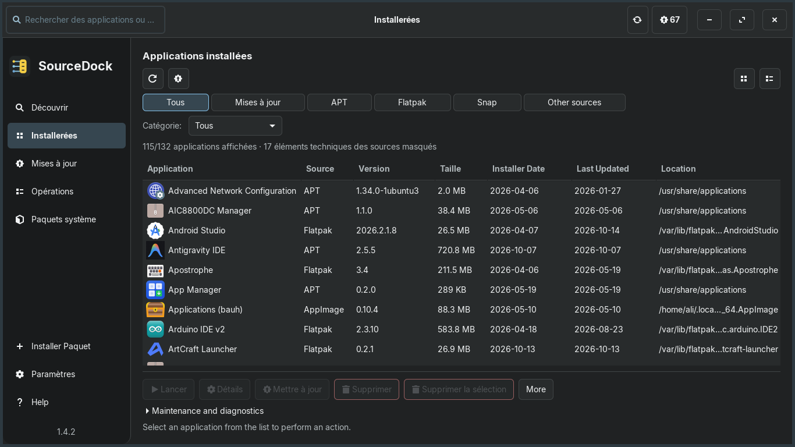
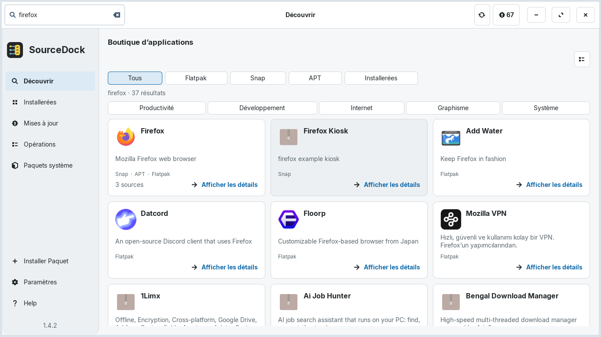
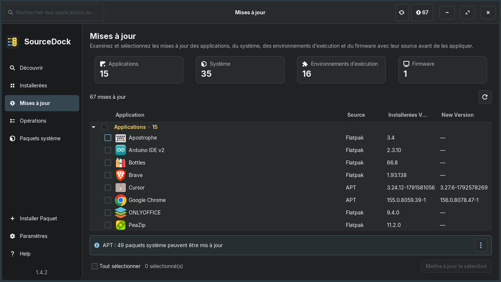

<div align="center">

[ **English** ](README.md) &nbsp;•&nbsp; [ **Türkçe** ](README.tr.md) &nbsp;•&nbsp; [ **Deutsch** ](README.de.md) &nbsp;•&nbsp; [ **Español** ](README.es.md) &nbsp;•&nbsp; [ **Português (BR)** ](README.pt_BR.md) &nbsp;•&nbsp; [ **Français** ](README.fr.md)

<br/>


# SourceDock

**Application de bureau et gestionnaire de paquets Linux natif en GTK 3.**

[](https://github.com/aliafacan/SourceDock/actions) [](LICENSE)

</div>

SourceDock réunit la recherche, l’installation, la mise à jour et la suppression des applications APT, Flatpak, Snap et des paquets locaux dans une interface réactive. Les fournisseurs sont interrogés de manière asynchrone et leurs erreurs sont affichées séparément.

## Captures d’écran

Les images suivantes montrent l’interface actuelle de la version 1.4.2 en français :





## Fonctionnalités

- Vues unifiées pour les applications installées, les paquets, les mises à jour et la boutique.
- Intégration APT et modèles pour DNF, Pacman et Zypper ; Flatpak et Snap restent optionnels.
- Prévisualisation des paquets `.deb` avec version, architecture, dépendances et état d’installation.
- Thèmes sombre, clair et système, échelle de 90 à 125 % et six langues.
- Vérification périodique des releases GitHub et auto-mise à jour DEB avec checksum SHA-256.
- Transactions asynchrones sécurisées avec verrous, délais et protection des identifiants.

## Installation

Téléchargez [SourceDock 1.4.2](https://github.com/aliafacan/SourceDock/releases/tag/v1.4.2) et son checksum :

```bash
sha256sum -c sourcedock_1.4.2_all.deb.sha256
sudo apt install ./sourcedock_1.4.2_all.deb
sourcedock
```

Lorsqu’une nouvelle version est disponible, SourceDock peut télécharger le DEB GitHub, vérifier son checksum et ouvrir le flux habituel de prévisualisation et d’autorisation. L’installation demande toujours votre confirmation et un redémarrage est nécessaire ensuite.

## Compatibilité

- Zorin OS 18.1 : installation réelle et cycle APT vérifiés.
- Ubuntu 22.04 et 24.04 : CI PASS, 296/296 tests sous Xvfb/Openbox.
- Debian 12 : compatible ; Debian 11 nécessite Python 3.10 ou plus récent.
- Fedora, openSUSE et Arch : support expérimental, sans paquet natif pour le moment.

Consultez la [matrice de compatibilité](docs/COMPATIBILITY.md).

## Développement

Prérequis : Python 3.10+, PyGObject, GTK 3, Xvfb, Openbox et `dpkg-dev`.

```bash
python3 main.py
xvfb-run -a bash -c 'openbox >/dev/null 2>&1 & wm=$!; trap "kill $wm 2>/dev/null || true" EXIT; /usr/bin/python3 tools/run_tests.py --require-wm'
bash packaging/build_deb.sh dist
```

Voir le [guide de contribution](CONTRIBUTING.md), l’[architecture](docs/ARCHITECTURE.md), la [localisation](docs/LOCALIZATION.md), le [journal des changements](CHANGELOG.md) et la [licence](LICENSE).
