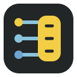
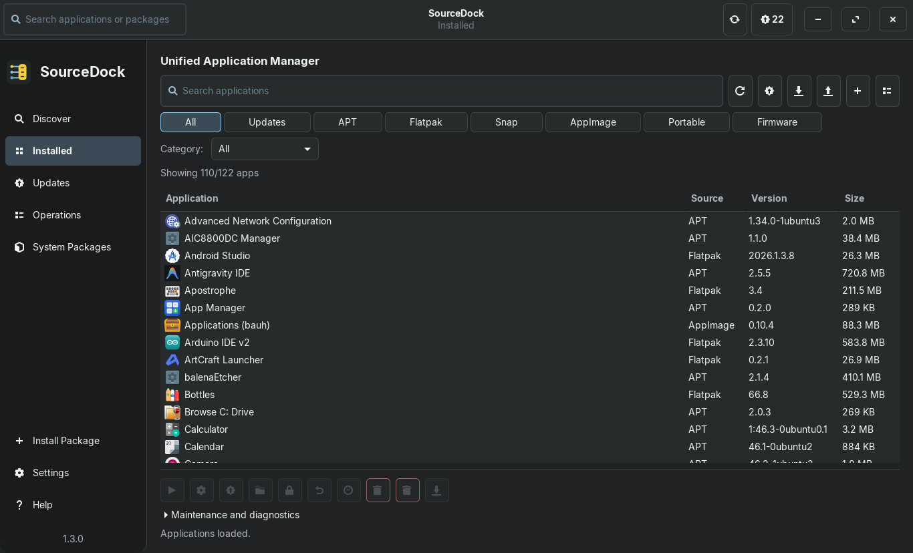
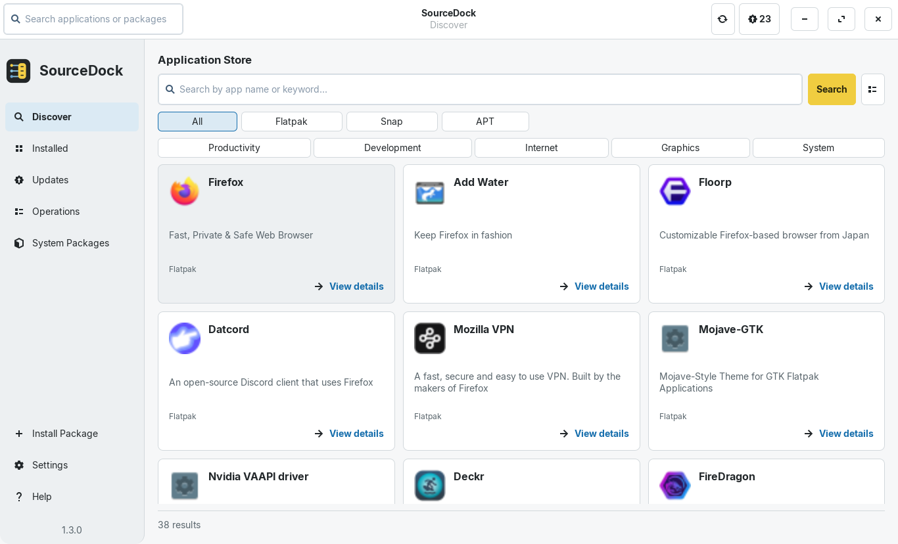
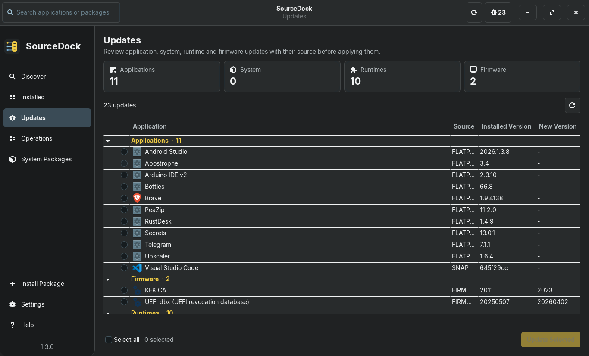

<div align="center">

[ **English** ](README.md) &nbsp;&bull;&nbsp; [ **Türkçe** ](README.tr.md)

<br/>



# SourceDock

**A native GTK 3 desktop application and package manager for Linux.**

[](https://github.com/aliafacan/SourceDock/actions)
[](LICENSE)
[](docs/COMPATIBILITY.md)

</div>

---

SourceDock is a modern, modular, and distro-agnostic Linux desktop software management tool built with Python and GTK 3. It provides a unified interface for browsing, discovering, updating, and removing system packages, Flatpaks, Snaps, and local software packages without compromising desktop responsiveness or system security.

## Screenshots

<div align="center">

### Installed Applications (Dark Mode)


### Software Discovery & Store (Light Mode)


### Unified Updates Center (Dark Mode)


<br/>

**Additional Screens:**
[Application Details](docs/screenshots/details-light-en-100-1366x768.png) &bull;
[Standalone Package Installer](docs/screenshots/installer-dark-en-100-1366x768.png) &bull;
[Settings & Preferences](docs/screenshots/settings-dark-en-100-1366x768.png) &bull;
[Operations Log](docs/screenshots/operations-dark-en-100-1366x768.png) &bull;
[Packages View](docs/screenshots/packages-dark-en-100-1366x768.png)

</div>

---

## Core Features

- **Unified Application Management**: Browse, search, inspect, and remove software across system packages and desktop applications with responsive sidebar navigation.
- **Distro-Agnostic Architecture**: Native package manager integration (APT, with parser models for DNF, Pacman, and Zypper) alongside optional Flatpak and Snap providers.
- **Standalone Package Installer**: Preview `.deb` packages before installation, checking description, architecture, file size, dependencies, and origin.
- **Safe Transaction Execution**: Non-blocking asynchronous command runner equipped with `flock`-based file locks, timeout bounds, and sensitive credential masking.
- **Transparent Operation History**: Bounded, inspectable transaction logs with user-controlled export and clearing.
- **Desktop Personalization**: Full Dark, Light, and System theme modes, 90%–125% user interface scaling, and six-language localization (TR/EN/DE/ES/PT-BR/FR).

---

## Installation

SourceDock is distributed as a standard Debian package (`.deb`) for Debian-based distributions (Zorin OS, Ubuntu, Debian, Linux Mint, etc.).

1. Download the matching `.deb` package and checksum from the [SourceDock 1.4.1 release](https://github.com/aliafacan/SourceDock/releases/tag/v1.4.1).
2. Verify the package checksum:
   ```bash
   sha256sum -c sourcedock_1.4.1_all.deb.sha256
   ```
3. Install the package via APT:
   ```bash
   sudo apt install ./sourcedock_1.4.1_all.deb
   ```
4. Launch SourceDock:
   ```bash
   sourcedock
   ```

*(Note: The `voltapp` command remains available as a backward-compatibility alias.)*

### GNOME Shell Desktop Integration (Optional)

The `.deb` package installs the GNOME desktop right-click integration (`sourcedock-menu@aliafacan.dev`) to `/usr/share/gnome-shell/extensions/`. GNOME Shell requires new extensions to be enabled explicitly by the user:

1. Enable the extension:
   ```bash
   gnome-extensions enable sourcedock-menu@aliafacan.dev
   ```
2. Verify its status:
   ```bash
   gnome-extensions info sourcedock-menu@aliafacan.dev
   ```

*(Note: If the extension is not immediately recognized by GNOME Shell after installation, log out and log back in to refresh your desktop session).*

---

## Compatibility & Support Matrix

| Environment | Status | Verification Evidence |
| :--- | :---: | :--- |
| **Zorin OS 18.1** | **Verified** | Real workstation testing: clean `.deb` installation, live desktop navigation, and actual APT package install/remove cycles. |
| **Zorin OS 17.x** | **Untested** | Core stack compatible with Ubuntu 22.04 base; covered by automated CI test suite. |
| **Ubuntu 22.04 & 24.04** | **CI PASS** | Verified in automated CI: 293/293 unit tests passing under Xvfb/Openbox, Ruff clean, compileall clean, and `.deb` package build. |
| **Debian 12** | **Compatible** | Compatible dependencies via `.deb` package (Python 3.11+ and GTK 3); live hardware testing pending. |
| **Debian 11** | **Unsupported** | Ships with Python 3.9 by default; SourceDock strictly requires Python >= 3.10. |
| **Fedora / openSUSE / Arch** | **Experimental** | Backend parser and execution abstractions verified via mocked test suites; native packaging (.rpm / PKGBUILD) not yet provided. |

For detailed environment test breakdowns and architectural boundaries, see [docs/COMPATIBILITY.md](docs/COMPATIBILITY.md).

---

## Limitations & Security

- **Do Not Run as Root**: SourceDock should always be launched from a regular user desktop session. Privileged package operations (APT/system actions) request authorization using `sudo` with secure in-memory caching and a strict 15-minute TTL.
- **Optional Tools**: Flatpak, Snap, and fwupd integrations are strictly optional. If not installed on the host, their sections remain inactive without error.
- **Hardware Firmware**: Firmware devices are inspected in read-only mode via `fwupd`; automated hardware flashing is never initiated.
- **GNOME Shell Extension**: The optional right-click extension (`sourcedock-menu@aliafacan.dev`) targets modern GNOME Shell (46+) AppMenu APIs.

---

## For Developers

### Prerequisites
- Python 3.10+
- PyGObject & GTK 3: `python3-gi`, `python3-gi-cairo`, `gir1.2-gtk-3.0`, `gir1.2-gdkpixbuf-2.0`
- Testing & Build: `xvfb`, `openbox`, `dpkg-dev`, `desktop-file-utils`

### Running from Source
```bash
# Run application directly from repository root
python3 main.py

# Inspect a local .deb package in standalone mini-installer mode
python3 main.py /path/to/package.deb
```

### Running the Test Suite
The full guarded test suite (293 tests) runs headless under an Xvfb display and Openbox window manager:
```bash
xvfb-run -a bash -c 'openbox >/dev/null 2>&1 & wm=$!; trap "kill $wm 2>/dev/null || true" EXIT; /usr/bin/python3 tools/run_tests.py --require-wm'
```

### Building the Debian Package
```bash
bash packaging/build_deb.sh dist
```

---

## Project Documentation

- [Contributing Guide](CONTRIBUTING.md)
- [System Architecture](docs/ARCHITECTURE.md)
- [Compatibility Matrix](docs/COMPATIBILITY.md)
- [Changelog](CHANGELOG.md)
- [Security Policy](SECURITY.md)
- [License (GPL-3.0)](LICENSE)
