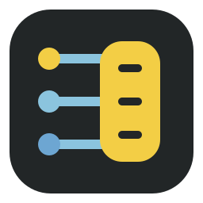
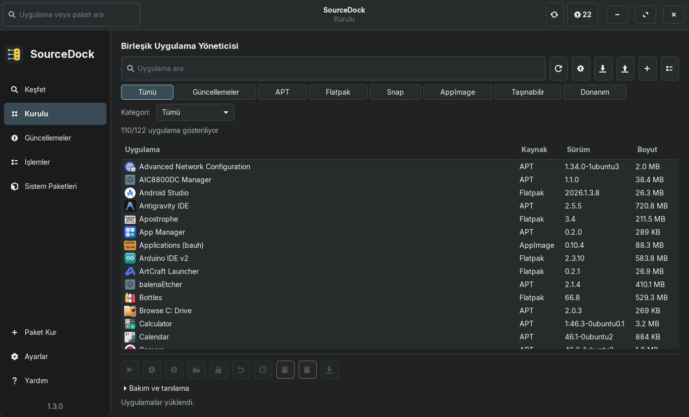

# SourceDock

Linux uygulamaları ve paketleri için GTK 3 yönetim aracı. / A native GTK 3 application and package manager for Linux.

[](https://github.com/aliafacan/SourceDock/actions)
[](LICENSE)

## Kurulum / Install

Debian ailesi, Python 3.10+ ve GTK 3 gerekir. `.deb` paketi diğer dağıtımların kurulum biçimi değildir.

```bash
./packaging/build_deb.sh
sudo apt install ./packaging/sourcedock_1.3.0_all.deb
sourcedock
```

Aynı sürüm yeniden derlendiyse `apt install --reinstall` kullanın. SHA-256 kontrolü:

```bash
cd packaging
sha256sum -c sourcedock_1.3.0_all.deb.sha256
```

Kaynak koddan çalıştırma / Run from source:

```bash
python3 main.py
```

GTK bağımlılıkları / GTK dependencies: `python3-gi`, `python3-gi-cairo`, `gir1.2-gtk-3.0`, `gir1.2-gdkpixbuf-2.0`.
Flatpak, Snap ve fwupd isteğe bağlıdır. Uygulamayı normal kullanıcı olarak çalıştırın; paket işlemleri gerektiğinde yetki ister.

GNOME uygulama menüsü sağ tık eylemleri / GNOME application-menu actions:

```bash
gnome-extensions enable sourcedock-menu@aliafacan.dev
```

Kurulumdan sonra oturumu kapatıp açmak gerekebilir. Kullanıcı dizininde eski bir eklenti varsa sistem kopyasını gölgeleyebilir; güncel eklentiyi yüklemek için:

```bash
gnome-extensions pack --force --out-dir packaging sourcedock/desktop/extension
gnome-extensions install --force packaging/sourcedock-menu@aliafacan.dev.shell-extension.zip
```

`install.sh`, APT tarafından yönetilen dosyaların üzerine yazmaz. `.deb` kaldırma için `sudo apt remove sourcedock` kullanın. Ayrıntılar: [Sorun Giderme](docs/TROUBLESHOOTING.md).

`voltapp` komutu ve eski MIME masaüstü kimliği, SourceDock geçişi için bir sürüm boyunca uyumluluk alias'ı olarak korunur.

## Ekran Görüntüleri / Screenshots

Çalışan uygulamadan gerçek sağlayıcı verileriyle alınmıştır; kurulum ve kaldırma işlemleri bu görüntüler için çalıştırılmamıştır.




[Güncellemeler](docs/screenshots/updates-dark-tr-100-1366x768.png) ·
[Ayrıntılar](docs/screenshots/details-light-en-100-1366x768.png) ·
[Mini Kurucu](docs/screenshots/installer-dark-tr-100-1366x768.png)

## Özellikler / Features

- Kalıcı sol gezinme, global arama, kurulu uygulamalar ve ayrı sistem paketi görünümü.
- APT/DNF/Pacman/Zypper, Flatpak, Snap, firmware ve runtime verileri için birleşik güncelleme listesi.
- Kaynak filtreleri, mağazada kart/tablo görünümü ve bilinen AppStream kimlikleriyle kaynak karşılaştırması.
- Gerçek metadata varsa yayıncı, lisans, web sitesi ve ekran görüntüleri; bilinmeyen bilgiler uydurulmaz.
- `.deb`, `.rpm`, `.AppImage`, Flatpak ve portable arşivler için bağımsız kurulum önizlemesi.
- Güvenli portable sahiplik kontrolü, sınırlandırılmış arşiv açma ve dosyayı çalıştırmayan AppImage incelemesi.
- Kaynakları salt okunur inceleme; uygulama listesini dışa/içe aktarma ve kurulumdan önce hedef önizlemesi.
- İşlem geçmişi, kişisel bilgilerin maskelenmesi, kullanıcı kontrollü temizleme ve dışa aktarma.
- Türkçe/İngilizce, Sistem/Açık/Koyu tema, 90/100/110/125% ölçek ve klavye erişimi.

Provider availability and real installation behavior depend on the host distribution. AppImage metadata currently uses the filename and ELF header; unknown signatures and publishers remain unverified. Native restore requires a matching distribution; Flatpak restore requires an explicit remote and uses user scope.

## Dağıtımlar / Compatibility

Zorin OS 18.1 üzerinde pencere açılışı, gerçek uygulama/paket verileri ve arayüz akışları doğrulandı. Ayrıcalıklı paket işlemleri otomatik testlerde taklit edilir.

Ubuntu 22.04/24.04 için sistem Python ve GI kullanan CI tanımlandı; uzaktaki CI sonucu burada doğrulanmış kabul edilmez. Debian, Fedora, openSUSE ve Arch için gerçek kurulum testleri bekliyor.

Tam durum tablosu: [Compatibility](docs/COMPATIBILITY.md).

## Sık Sorulanlar / FAQ

**Yeni derlediğim paket neden kurulmadı?** APT aynı sürümü atlayabilir. Yeni sürüm numarası veya `--reinstall` kullanın.

**Sağ tık eylemleri neden görünmüyor?** GNOME Shell eklentisi etkin olmalı. Eski kullanıcı kopyası ve oturum önbelleği için [Sorun Giderme](docs/TROUBLESHOOTING.md) bölümüne bakın.

**Portable uygulamam neden kaldırılamıyor?** Eski ya da değiştirilmiş kayıtların sahipliği doğrulanamıyorsa dizin silinmez. Bu koruma kişisel dosyaları korur.

**Why is cancellation unavailable?** Native package database and firmware operations must finish. External APT/DPKG processes are read-only entries in SourceDock's process view.

**Why are there no ratings or screenshots for an app?** SourceDock shows only available provider metadata.

## Katkı / Contribute

```bash
/usr/bin/python3 -m unittest discover -s tests -v
```

CI runs GUI tests under Xvfb. Development lint: install `requirements-dev.txt` into a virtual environment, then run `ruff check .`.

[Katkı Rehberi](CONTRIBUTING.md) · [Mimari](docs/ARCHITECTURE.md) ·
[Tasarım](docs/UI_DESIGN.md) · [Uygulama Raporu](docs/ROADMAP_IMPLEMENTATION.md) ·
[Değişiklikler](CHANGELOG.md) · [Güvenlik](SECURITY.md) · [Lisans](LICENSE)
