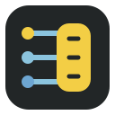
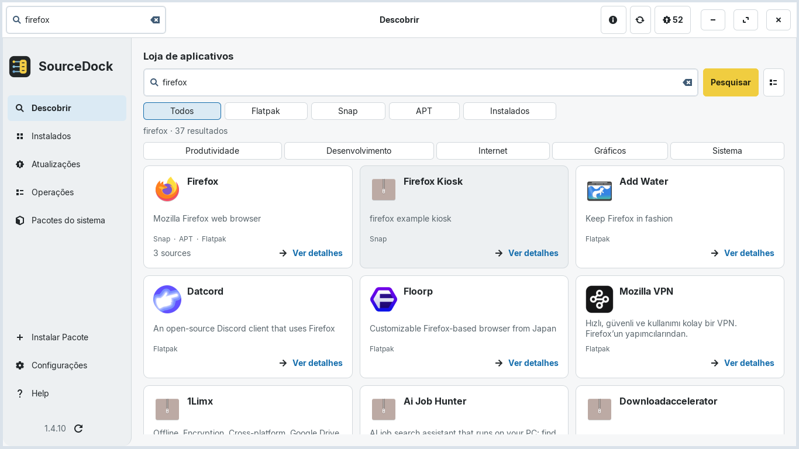
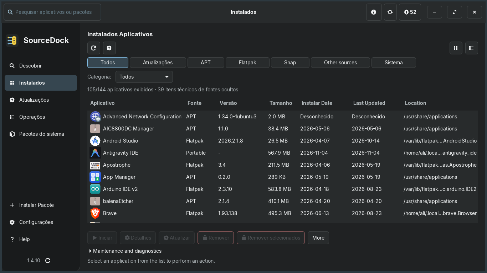
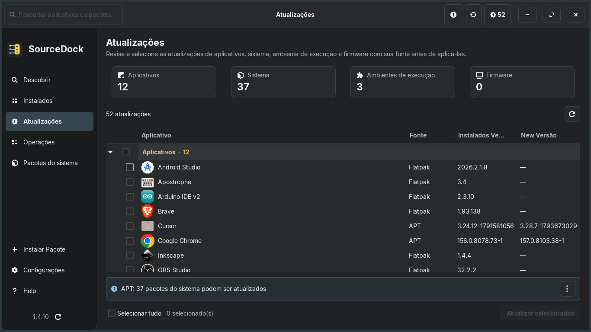
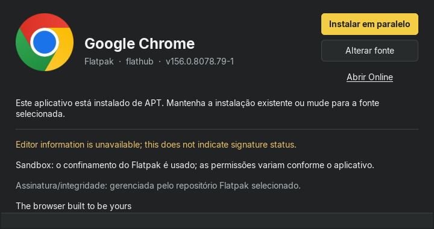
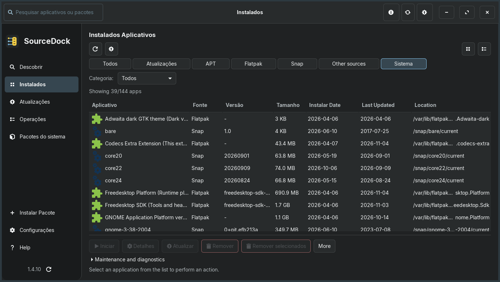

<div align="center">

[ **English** ](README.md) &nbsp;•&nbsp; [ **Türkçe** ](README.tr.md) &nbsp;•&nbsp; [ **Deutsch** ](README.de.md) &nbsp;•&nbsp; [ **Español** ](README.es.md) &nbsp;•&nbsp; [ **Português (BR)** ](README.pt_BR.md) &nbsp;•&nbsp; [ **Français** ](README.fr.md)

<br/>



# SourceDock

**Aplicativo de desktop e gerenciador de pacotes Linux nativo em GTK 3.**

[](https://github.com/aliafacan/SourceDock/actions) [](LICENSE)

</div>

O SourceDock reúne a busca, instalação, atualização e remoção de aplicativos APT, Flatpak, Snap e pacotes locais em uma interface responsiva. As consultas são assíncronas e os erros de cada provedor são mostrados separadamente.

## Novidades da versão 1.4.10

- **Inicialização mais rápida:** a lista salva é reutilizada quando os bancos de pacotes e os indicadores de instalação não mudam. Alterações externas, cache expirado ou F5 iniciam uma nova varredura. O Antigravity é associado à classe definitiva da janela.
- **Listas estáveis:** após instalar, remover ou atualizar, apenas a fonte afetada é reconciliada, sem recarregar a página ou repetir a busca de atualizações.
- **Filtro Sistema separado:** runtimes Flatpak e pacotes base Snap instalados ficam visíveis mesmo sem atualizações. Sua remoção exige aviso claro e confirmação digitando o nome do pacote.
- **Continuar durante operações:** a busca e os filtros permanecem disponíveis. Gerenciadores diferentes podem trabalhar em paralelo; alterações na mesma base de pacotes entram em fila.
- **Alterar a fonte de um aplicativo:** instalações nativas, Flatpak e Snap equivalentes são reconhecidas. Instale em paralelo ou altere a fonte. A nova instalação é verificada antes de remover apenas a cópia antiga escolhida, sem purge. Perfis e sessões não são transferidos automaticamente.
- **Progresso mais claro:** uma única barra de progresso medido, registros detalhados opcionais, seletor de arquivos legível e melhores ícones e integração de janelas Electron portáteis.
- **Busca robusta:** Snap recebe até 15 segundos; resultados rápidos de outras fontes aparecem sem esperar. Tempos esgotados exibem mensagens traduzidas para tentar novamente, em vez de comandos internos.

Use [build.sh](build.sh) para empacotar e instalar as fontes atuais. O script verifica o checksum e instala ou reinstala com APT; solicita privilégios de administrador apenas para instalar.

```bash
./build.sh
```

## Capturas de tela

Novas capturas da versão 1.4.10: janelas principais em 1366×768 e diálogos em seu tamanho próprio.





### Alterar a fonte de um aplicativo



### Componentes compartilhados do sistema



Capturas do SourceDock 1.4.10 com metadados reais consultados em modo somente leitura; nenhuma operação de pacotes foi executada.

## Recursos

- Visões unificadas para aplicativos instalados, pacotes, atualizações e loja.
- Seções claras para loja, aplicativos instalados, atualizações, operações, pacotes do sistema, instalação de pacotes, configurações e ajuda; as atualizações são agrupadas em aplicativos, sistema, runtimes e firmware.
- APT como integração nativa principal; DNF, Pacman e Zypper são experimentais; Flatpak e Snap são opcionais.
- Pré-visualização de pacotes `.deb` com versão, arquitetura, dependências e status.
- Temas escuro, claro e do sistema, escala de 90–125 % e seis idiomas.
- Verificação periódica de releases do GitHub e autoatualização por DEB com SHA-256 verificado.
- Operações assíncronas seguras, com bloqueios, limites de tempo e proteção de credenciais.

## Instalação

Baixe o [SourceDock 1.4.10](https://github.com/aliafacan/SourceDock/releases/tag/v1.4.10) e o checksum:

```bash
sha256sum -c sourcedock_1.4.10_all.deb.sha256
sudo apt install ./sourcedock_1.4.10_all.deb
sourcedock
```

Quando uma nova versão está disponível, o SourceDock pode baixar o DEB do GitHub, verificar o checksum e abrir o fluxo normal de pré-visualização e autorização. A instalação sempre exige confirmação do usuário; depois é necessário reiniciar o aplicativo.

### Desinstalação

Para remover o SourceDock mantendo as configurações do usuário:
```bash
sudo apt remove sourcedock
```

Para remover completamente o SourceDock, a configuração do pacote e o cache local:
```bash
sudo apt purge sourcedock
rm -rf ~/.cache/sourcedock ~/.config/sourcedock
sudo apt autoremove
```

Se o pacote antigo `voltapp` estiver instalado:
```bash
sudo apt purge voltapp
```

## Compatibilidade

- Zorin OS 18.1: instalação real e ciclo APT verificados.
- Ubuntu 22.04 e 24.04: cobertos pelo fluxo CI com Xvfb/Openbox, unittest, Ruff, compileall e compilação `.deb`; não afirmamos aqui um resultado remoto atual.
- Debian 12: compatível; Debian 11 requer Python 3.10 ou mais recente.
- Fedora, openSUSE e Arch: suporte experimental, sem pacotes nativos por enquanto.

Consulte a [matriz de compatibilidade](docs/COMPATIBILITY.md).

## Desenvolvimento

Requisitos: Python 3.10+, PyGObject, GTK 3, Xvfb, Openbox e `dpkg-dev`.

```bash
python3 main.py
xvfb-run -a bash -c 'openbox >/dev/null 2>&1 & wm=$!; trap "kill $wm 2>/dev/null || true" EXIT; /usr/bin/python3 tools/run_tests.py --require-wm'
bash packaging/build_deb.sh dist
```

Veja o [guia de contribuição](CONTRIBUTING.md), o [código de conduta](CODE_OF_CONDUCT.md), a [política de segurança](SECURITY.md), a [arquitetura](docs/ARCHITECTURE.md), a [localização](docs/LOCALIZATION.md), o [changelog](CHANGELOG.md) e a [licença](LICENSE).
