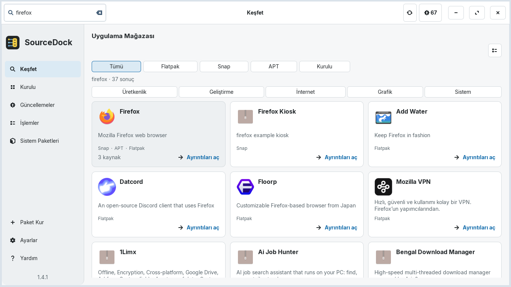
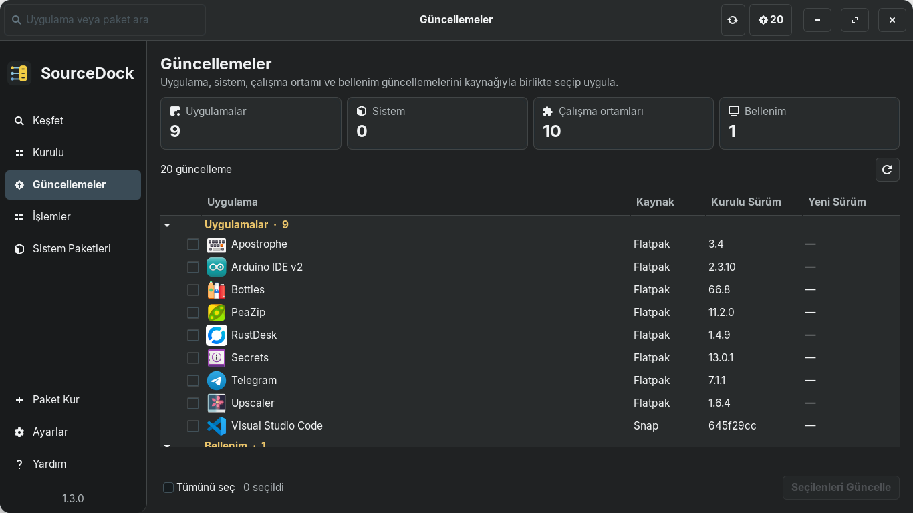

<div align="center">

[ **English** ](README.md) &nbsp;&bull;&nbsp; [ **Türkçe** ](README.tr.md)

<br/>


# SourceDock

**Linux için yerel GTK 3 masaüstü uygulama ve paket yöneticisi.**

[](https://github.com/aliafacan/SourceDock/actions)
[](LICENSE)
[](docs/COMPATIBILITY.md)

</div>

---

SourceDock; Python ve GTK 3 ile geliştirilmiş modern, modüler ve dağıtımdan bağımsız bir Linux masaüstü yazılım yönetim aracıdır. Sistem paketleri, Flatpak'ler, Snap'ler ve yerel paketler için masaüstü akıcılığından ve sistem güvenliğinden ödün vermeden tek noktadan arama, inceleme, güncelleme ve kaldırma arayüzü sunar.

## Ekran Görüntüleri

<div align="center">

### Yüklü Uygulamalar (Koyu Tema)


### Yazılım Keşfi ve Mağaza (Açık Tema)


### Birleşik Güncelleme Merkezi (Koyu Tema)


<br/>

**Diğer Ekranlar:**
[Uygulama Ayrıntıları](docs/screenshots/details-light-tr-100-1366x768.png) &bull;
[Müstakil Paket Kurucu](docs/screenshots/installer-dark-tr-100-1366x768.png) &bull;
[Ayarlar ve Tercihler](docs/screenshots/settings-dark-tr-100-1366x768.png) &bull;
[İşlem Günlüğü](docs/screenshots/operations-dark-tr-100-1366x768.png) &bull;
[Paketler Görünümü](docs/screenshots/packages-dark-tr-100-1366x768.png)

</div>

---

## Temel Özellikler

- **Birleşik Uygulama Yönetimi**: Duyarlı kenar çubuğu gezintisiyle sistem paketleri ve masaüstü uygulamaları arasında arama yapma, ayrıntıları inceleme ve kaldırma.
- **Dağıtımdan Bağımsız Mimari**: Yerel paket yöneticisi entegrasyonu (APT; DNF, Pacman ve Zypper ayrıştırıcı modelleri) ile isteğe bağlı Flatpak ve Snap sağlayıcıları.
- **Müstakil Paket Kurucu**: Yerel `.deb` paketlerini kurmadan önce açıklama, mimari, dosya boyutu, bağımlılıklar ve kaynak açısından önizleme imkânı.
- **Güvenli İşlem Yürütme**: Dosya kilitleri (`flock`), zaman aşımı sınırları ve parola/kullanıcı yolu redaksiyonu ile donatılmış asenkron komut çalıştırıcısı.
- **Şeffaf İşlem Geçmişi**: Kullanıcı denetiminde dışa aktarılabilen ve temizlenebilen kayıt defteri.
- **Masaüstü Kişiselleştirme**: Sistem, Açık ve Koyu tema seçenekleri; %90–%125 arayüz ölçekleme desteği ve tam Türkçe / İngilizce yerelleştirme.

---

## Kurulum

SourceDock, Debian tabanlı dağıtımlar (Zorin OS, Ubuntu, Debian, Linux Mint vb.) için standart Debian paketi (`.deb`) olarak dağıtılmaktadır.

1. En güncel `.deb` paketini ve sağlama özetini [GitHub Releases](https://github.com/aliafacan/SourceDock/releases) sayfasından indirin.
2. Sağlama özetini doğrulayın:
   ```bash
   sha256sum -c sourcedock_1.3.0_all.deb.sha256
   ```
3. Paketi APT ile kurun:
   ```bash
   sudo apt install ./sourcedock_1.3.0_all.deb
   ```
4. Uygulamayı başlatın:
   ```bash
   sourcedock
   ```

*(Not: `voltapp` komutu 1.3.0 sürüm geçişi boyunca geriye dönük uyumluluk için alias olarak korunmaktadır).*

---

## Uyumluluk ve Destek Matrisi

| Ortam | Durum | Doğrulama Kanıtı |
| :--- | :---: | :--- |
| **Zorin OS 17 / 18** | **Doğrulandı** | Gerçek kullanıcı ortamı testi: Polkit ile temiz `.deb` kurulumu, canlı masaüstü kullanımı ve gerçek APT paketi kurma/kaldırma döngüsü. |
| **Ubuntu 22.04 & 24.04** | **CI PASS** | Otomatik CI doğrulaması: Xvfb/Openbox altında 281/281 test, Ruff ve compileall temiz, `.deb` paket inşası başarılı. |
| **Debian 11 / 12** | **Destekleniyor** | `.deb` paketi üzerinden uyumlu (Python 3.10+ ve GTK 3 gerektirir). |
| **Fedora / openSUSE / Arch** | **Deneysel** | Ayrıştırıcı ve yürütme katmanı birim testlerle doğrulandı; yerel paketleme (.rpm / PKGBUILD) henüz sunulmamaktadır. |

Ayrıntılı ortam testleri ve mimari sınırlar için [docs/COMPATIBILITY.md](docs/COMPATIBILITY.md) belgesine bakınız.

---

## Sınırlar ve Güvenlik

- **Root Olarak Çalıştırmayın**: SourceDock daima normal kullanıcı oturumundan açılmalıdır. Yetki gerektiren paket işlemlerinde (APT/sistem eylemleri) bellek içi önbelleğe ve 15 dakikalık TTL sınırına sahip `sudo` üzerinden güvenli yetkilendirme istenir.
- **İsteğe Bağlı Araçlar**: Flatpak, Snap ve fwupd entegrasyonları tamamen isteğe bağlıdır; sistemde bulunmadıklarında hata vermeksizin devre dışı kalırlar.
- **Donanım Yazılımı**: Firmware cihazları salt okunur olarak incelenir; otomatik donanım yazımı asla başlatılmaz.
- **GNOME Shell Eklentisi**: İsteğe bağlı sağ tık menü eklentisi (`sourcedock-menu@aliafacan.dev`) modern GNOME Shell (46+) AppMenu API'lerini hedefler.

---

## Geliştiriciler İçin

### Gereksinimler
- Python 3.10+
- PyGObject & GTK 3: `python3-gi`, `python3-gi-cairo`, `gir1.2-gtk-3.0`, `gir1.2-gdkpixbuf-2.0`
- Test ve Paketleme: `xvfb`, `openbox`, `dpkg-dev`, `desktop-file-utils`

### Kaynak Koddan Çalıştırma
```bash
# Depo kökünden uygulamayı çalıştırma
python3 main.py

# Yerel bir .deb paketini müstakil kurucu modunda inceleme
python3 main.py /dosya/yolu/paket.deb
```

### Test Takımını Çalıştırma
Korumalı tam test takımı (281 test), Xvfb ekranı ve Openbox pencere yöneticisi altında çalıştırılır:
```bash
xvfb-run -a bash -c 'openbox >/dev/null 2>&1 & wm=$!; trap "kill $wm 2>/dev/null || true" EXIT; /usr/bin/python3 tools/run_tests.py --require-wm'
```

### Debian Paketini Derleme
```bash
bash packaging/build_deb.sh dist
```

---

## Proje Dokümantasyonu

- [Katkı Rehberi](CONTRIBUTING.md)
- [Mimari Yapı](docs/ARCHITECTURE.md)
- [Uyumluluk Tablosu](docs/COMPATIBILITY.md)
- [Değişiklik Günlüğü](CHANGELOG.md)
- [Güvenlik Politikası](SECURITY.md)
- [Lisans (GPL-3.0)](LICENSE)
